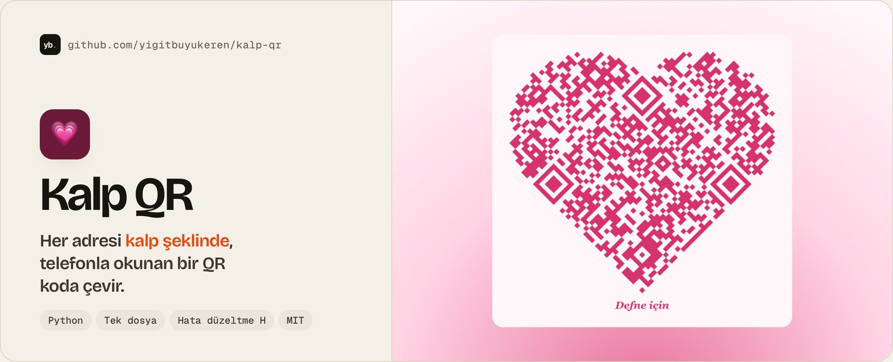
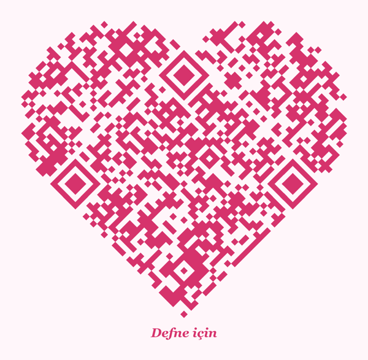

<a href="https://github.com/yigitbuyukeren/kalp-qr#-nasıl-kullanılır">
  <picture>
    <source media="(prefers-color-scheme: dark)" srcset="docs/banner-dark.jpg">
    
  </picture>
</a>

<div align="center">

**[🚀 Nasıl kullanılır](#-nasıl-kullanılır)** &nbsp;·&nbsp; **[📋 Betiği aç](kalp-qr.py)** &nbsp;·&nbsp; **[🐞 Sorun bildir](https://github.com/yigitbuyukeren/kalp-qr/issues)**

[](LICENSE)

-E8480C?style=flat-square&labelColor=16150F)

[](https://github.com/yigitbuyukeren/kalp-qr/commits/main)

🇹🇷 [Türkçe](#-türkçe) &nbsp;·&nbsp; 🇬🇧 [English](#-english)

</div>

<details open>
<summary><h2>🇹🇷 Türkçe</h2></summary>

Bir adresi **kalp şeklinde, telefonla okunan** bir QR koda çevirir. **Tek dosya, iki bağımlılık, hesap ya da sunucu yok.** Davetiyeye, hediye kartına, çiçeğe, tişörte ya da bir doğum günü sürprizine koyabilirsin.

<p align="center"></p>

| 💗 **Kalp şeklinde** | 📱 **Okunur kalır** | 🎨 **Kendi renklerin** | 🔒 **%100 yerel** |
|:---:|:---:|:---:|:---:|
| Döndürülmüş QR + yuvarlak kulaklar | En yüksek hata düzeltme (H) | Kalp ve arka plan rengi seçilir | Adres bilgisayarından çıkmaz |

### 🚀 Nasıl kullanılır
1. 📦 Gerekenleri kur:
   ```bash
   pip install -r requirements.txt
   ```
2. 💗 Çalıştır:
   ```bash
   python3 kalp-qr.py https://site-adresin -o kalp-qr.png -t "Defne için"
   ```
3. 📱 `kalp-qr.png` dosyasını telefonunun kamerasıyla okut, adresi açtığından emin ol, sonra bas.

| Seçenek | Ne işe yarar |
|---|---|
| `url` | QR kodun açacağı adres (zorunlu). |
| `-o`, `--out` | Çıktı dosyası, PNG. Varsayılan `kalp-qr.png`. |
| `-t`, `--text` | Kalbin altına yazılacak kısa yazı. Boş bırakılırsa yazı olmaz. |
| `--renk` | Kalp rengi, `#d6336c` ya da `#f06` gibi. Varsayılan `#d6336c`. |
| `--arka` | Arka plan rengi. Varsayılan `#fff6fa`. |
| `--gap` | QR ile kalp kulakları arasındaki boşluk (modül). Varsayılan `1`. |

```bash
# Mor kalp, koyu arka plan
python3 kalp-qr.py https://site-adresin --renk "#c9a7ff" --arka "#1b1238" -o mor.png
```

> [!TIP]
> Açık renkli kalp ve koyu arka plan çiftlerini bazı telefonlar okumakta zorlanır. Emin olmak için basmadan önce telefonunla dene.

### 🔧 Nasıl çalışıyor
1. Adres, **en yüksek hata düzeltme seviyesiyle (H)** bir QR koda dönüşür. Bu seviye kodun yaklaşık %30'u bozulsa da okunmasını sağlar.
2. QR kod **45 derece döndürülür**, kare bir kod köşesinde duran bir elmasa dönüşür.
3. Elmasın iki üst kenarına **yarım daireler (kulaklar)** eklenir ve kalp olur. Kulaklar, kodun modül ızgarasında rastgele ama her seferinde aynı biçimde doldurulur, aynı adres her zaman aynı kalbi verir.
4. Kodun kendisi ve üç köşe işareti hiç bozulmaz. Kulaklar sadece kodun dışındaki boşluğu doldurur, okuyucu onları süs olarak görür.

### 🖨️ Basarken
- 📏 En az **5 cm** genişlik kullan.
- 📄 Açık renkli, mat bir kağıt seç. Parlak yüzeyler ışık yansıtıp okumayı zorlaştırır.
- 🔍 Adres uzadıkça kod sıklaşır. Kısa bir adres (ya da kısaltılmış bir bağlantı) daha rahat okunur.

### 🛠️ Geliştirme
```bash
python3 -m unittest discover -s tests
```
Testler PNG'nin üretildiğini, aynı adresin aynı görseli verdiğini ve renk ayrıştırmayı denetler. `opencv-python` kuruluysa üretilen kalbi gerçekten okuyup adresi geri alır. Görselde yazı için macOS'ta Georgia, başka sistemlerde DejaVu Serif aranır; bulunamazsa PIL'in varsayılan yazı tipi kullanılır.

### 🎂 Doğum günü sürprizi
Bu betik, [Doğum Günü Sürprizi](https://github.com/yigitbuyukeren/dogum-gunu-surprizi) projesinde sürpriz sayfasının adresini kalp QR koda çevirmek için doğdu. Sürprizi kendin hazırlamak için [oluşturma sayfasına](https://yigitbuyukeren.com/dogum-gunu/olustur/) bak.

### 📜 Lisans

[MIT](LICENSE): kullanabilir, değiştirebilir, dağıtabilirsin. ⭐ Birini mutlu ettiyse yıldız vermeyi unutma!

</details>

<details>
<summary><h2>🇬🇧 English</h2></summary>

Turns an address into a **heart-shaped QR code that still scans.** One Python file, two dependencies, no account, no server. Put it on an invitation, a gift card, a flower or a T-shirt. The CLI's help text and messages are in Turkish.

```bash
pip install -r requirements.txt
python3 kalp-qr.py https://your-site.example -o heart.png -t "For Defne"
```

**Options:** `-o` output PNG · `-t` short caption under the heart · `--renk` heart colour (`#d6336c`) · `--arka` background colour (`#fff6fa`) · `--gap` space between the code and the ears, in modules (`1`).

**How it works:** the address becomes a QR code with the highest error correction level (H, about 30% of the code can be damaged). The code is rotated 45 degrees into a diamond, and two half-circle "ears" are added to its upper edges. The code and its three finder patterns are never touched; the ears only fill the empty space outside, so readers treat them as decoration. The ears are filled from a fixed seed, so the same address always gives the same heart.

**Printing:** at least 5 cm wide, on light, matte paper. Shorter addresses give a looser, easier-to-read code. Always scan it with a phone before printing.

Run the tests with `python3 -m unittest discover -s tests`. It started life in the [birthday surprise](https://github.com/yigitbuyukeren/dogum-gunu-surprizi) project.

Released under the [MIT License](LICENSE).

</details>
